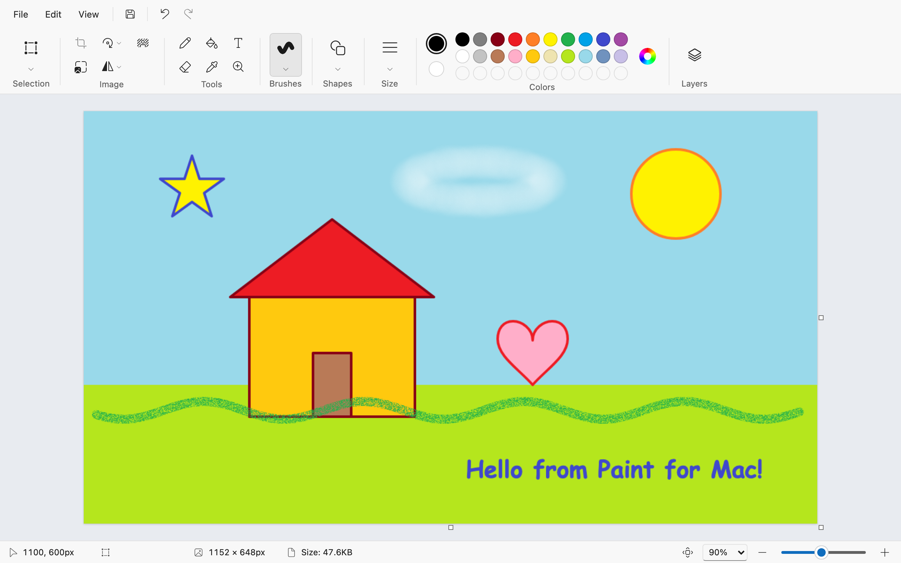
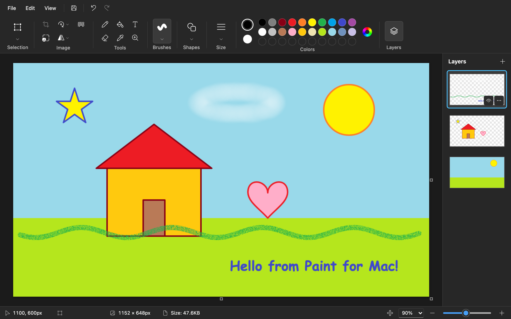
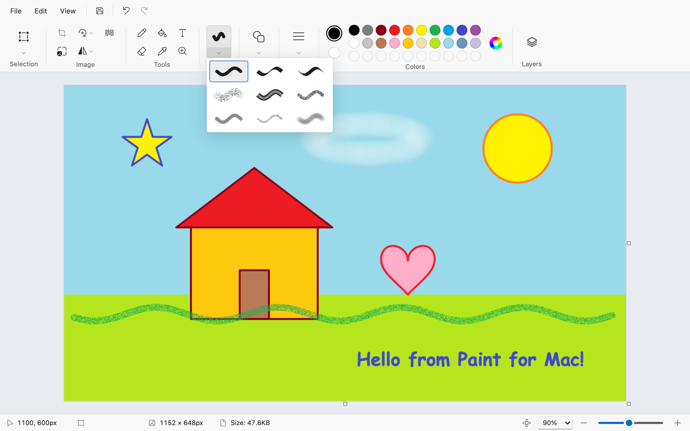
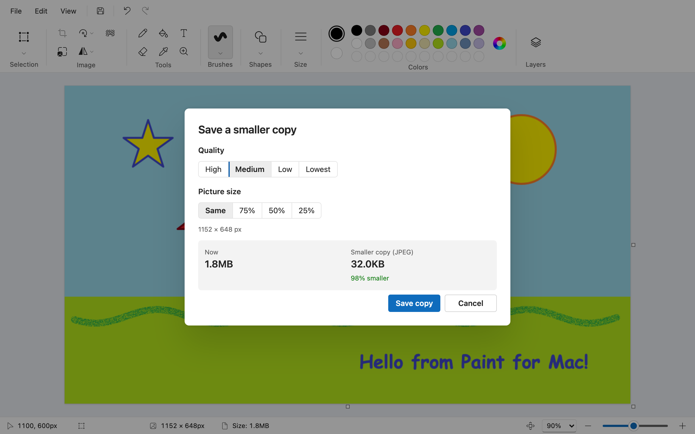

# Paint for Mac

[](https://github.com/osanchez25/mac-paint/actions/workflows/ci.yml)
[](LICENSE)

A Mac app that looks and works like Windows 11 Paint. Built with Tauri 2, React and
Microsoft's Fluent UI (the same design kit Windows 11 uses). Fast, small (about 5 MB)
and offline.



| Dark mode with the Layers panel | Brushes | Save a smaller copy |
| --- | --- | --- |
|  |  |  |

## Download

Get the latest `.dmg` from [Releases](https://github.com/osanchez25/mac-paint/releases),
open it and drag **Paint** to **Applications**. One download works on Apple silicon
and Intel Macs, with macOS 14 or later.

The app is not signed with an Apple Developer ID, so macOS blocks it the first time.
Open **System Settings → Privacy & Security** and click **Open Anyway**, or run:

```bash
xattr -dr com.apple.quarantine /Applications/Paint.app
```

To get **Edit in Paint** in Finder's right-click menu, download
`Edit-in-Paint-Quick-Action.zip` from the same release, unzip it and double-click the
workflow to install it.

## What it does

- **Ribbon like Paint's:** Selection, Image, Tools, Brushes, Shapes, Size, Colors.
- **Tools:** pencil, fill, text, eraser, color picker and magnifier. Left click uses
  color 1, right click (or Ctrl-click) uses color 2.
- **Brushes:** brush, calligraphy brush and pen, airbrush, oil, crayon, marker, natural
  pencil and watercolor.
- **Shapes:** Paint's 23 shapes. After you draw a shape you can still move it, resize
  it and change its color, size, outline and fill, until you click outside it.
- **Selection:** rectangle and free-form; move, resize, Cmd-drag to copy, transparent
  selection, invert selection (Shift+Cmd+I), crop, delete.
- **Image:** rotate, flip, resize and skew, and drag the canvas handles to change the
  canvas size.
- **Remove background:** keeps the person, animal or object and makes the rest
  transparent (on the selection, or the whole picture). It uses the Mac's own subject
  detection (Vision), so it works offline. It needs macOS 14 or later.
- **Layers:** the Layers button opens Paint's Layers panel. Add, duplicate, delete,
  merge down, hide/show, and drag to reorder. The eraser makes holes on upper layers.
  Crop, rotate, flip and resize change every layer. Saving merges the visible layers
  into one picture, like Paint.
- **Text:** font, size, bold, italic, underline, strikethrough, and a transparent or
  filled background.
- **Colors:** the 20-color palette, 10 custom colors and Edit colors.
- **Files:** open, save and save as (PNG, JPEG, BMP, GIF), print, image properties.
  **File → Save a smaller copy** makes a smaller JPEG (choose quality and picture size,
  see the new file size before saving) and leaves the open picture as it is.
  Transparent areas show as a checkerboard and stay transparent in PNG and GIF.
  Copy and paste work with the Mac clipboard, and you can drop a picture on the window.
- **View:** zoom (menu, slider, Cmd+scroll, pinch), fit to window, gridlines, status
  bar, full screen. Light and dark follow the Mac's appearance.
- **Finder:** Paint shows in **Open With** for pictures. The **Edit in Paint** Quick
  Action is in the right-click menu under Quick Actions.

Shortcuts are Paint's with Cmd instead of Ctrl (Cmd+Z, Cmd+Y, Cmd+A, Shift+Cmd+X to
crop, Cmd+E for properties). Resize and skew is Ctrl+W, because Cmd+W closes the window
on a Mac.

## Build from source

```bash
npm install
npm run tauri dev          # the Mac app with live reload
npm run dev                # the same UI in a browser at http://localhost:1420
npm test                   # unit tests for the drawing logic
npm run tauri build -- --bundles app
./scripts/install.sh       # copies Paint.app to /Applications, adds "Edit in Paint"
```

Building needs Rust (`brew install rust`) and the Xcode command line tools.

## Code layout

- `src/core/`: pure logic with tests (geometry, flood fill, shapes, undo history, BMP,
  resize math, text wrapping).
- `src/editor/`: the editor. It holds the picture, the preview layer, the tools, the
  selection, the brush engines and the commands. It has no React.
- `src/platform/`: file, clipboard and window access. `tauri-platform.ts` is the Mac
  version; `browser-platform.ts` is for running in a browser.
- `src/ui/`: the React screens (menu row, ribbon, canvas, status bar, dialogs).
- `src-tauri/`: the Mac shell (file read/write, Finder "Open With", menu bar, print).
- `macos/Edit in Paint.workflow`: the Finder Quick Action.
- `macos/remove-bg.swift`: the Remove background helper. `scripts/build-helper.sh` compiles
  it (the Tauri build runs it), and the app bundle carries it next to the main binary.

## Not built yet

Image Creator and Cocreator, rulers, TIFF saving, "Set as desktop background",
and textured shape fills.

## Contributing

Issues and pull requests are welcome. The goal is simple: **look and work like Windows 11
Paint**, so a change should match what Paint does (screenshots of Paint in an issue help a
lot).

- Keep logic out of React: drawing rules go in `src/editor/` or `src/core/`, screens in
  `src/ui/`.
- New pure logic in `src/core/` gets a unit test.
- Before opening a pull request, run `npx tsc --noEmit` and `npm test` (CI runs both).
- To publish a release, push a version tag (`git tag v0.2.0 && git push --tags`): the
  Release workflow builds the `.dmg` on a Mac and attaches it.

## License

[MIT](LICENSE) © 2026 Oscar Sanchez.

This is an independent project. It is not made by, endorsed by or affiliated with
Microsoft. "Windows" and "Paint" are trademarks of Microsoft Corporation, used here
only to describe what the app imitates. The app icon is original. The Fluent UI
components and icons are Microsoft's open-source MIT-licensed libraries.
